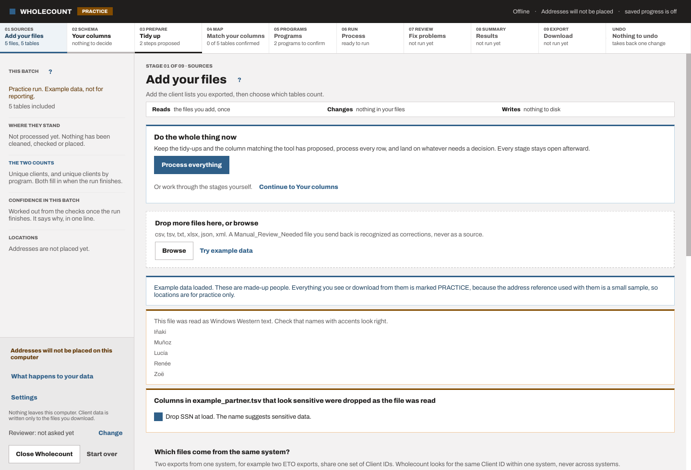
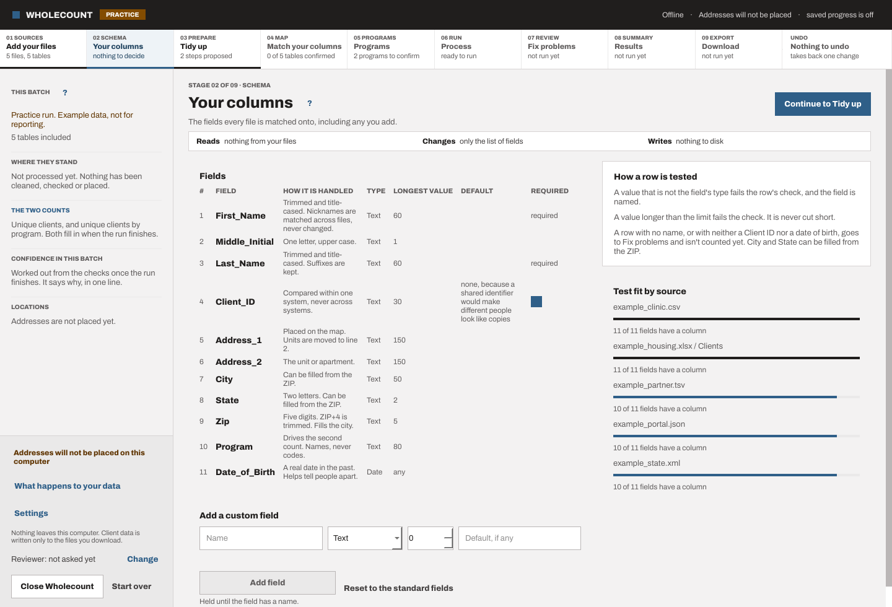
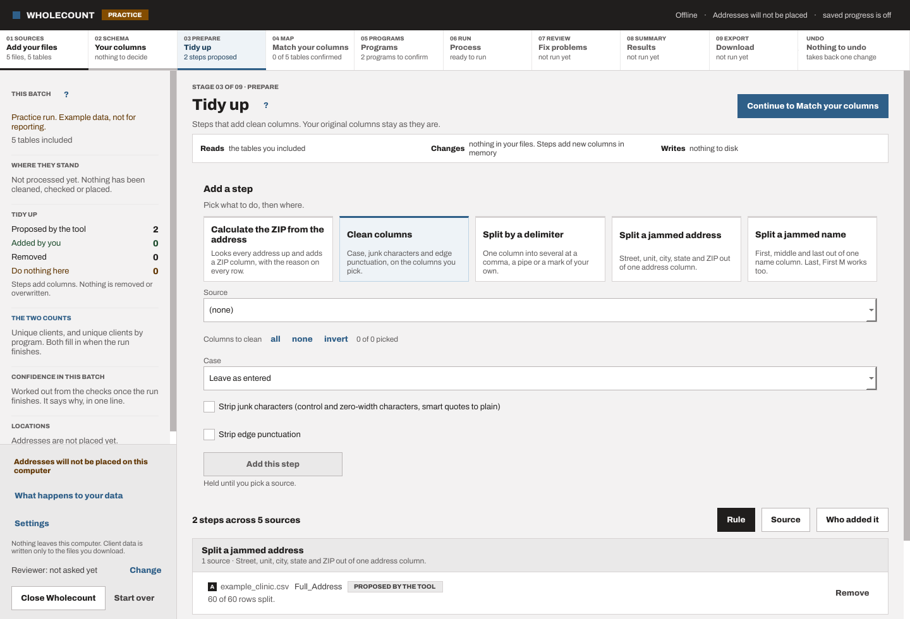
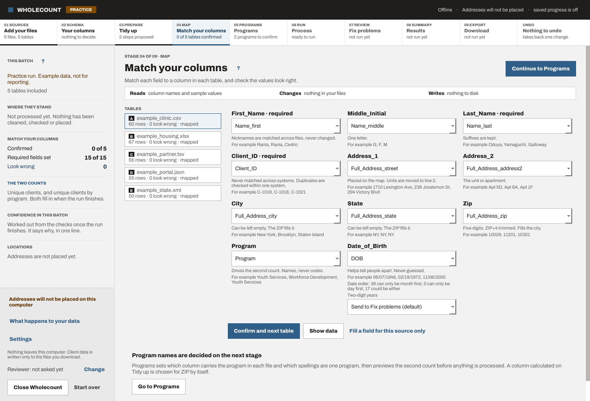
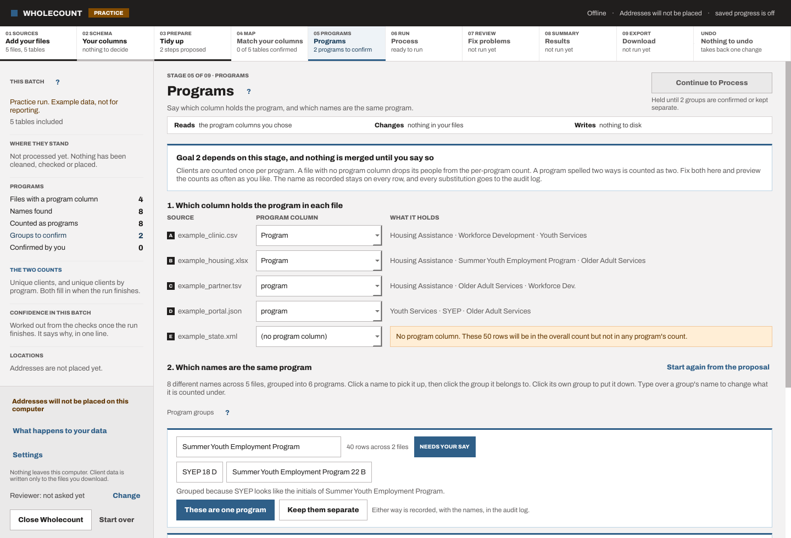
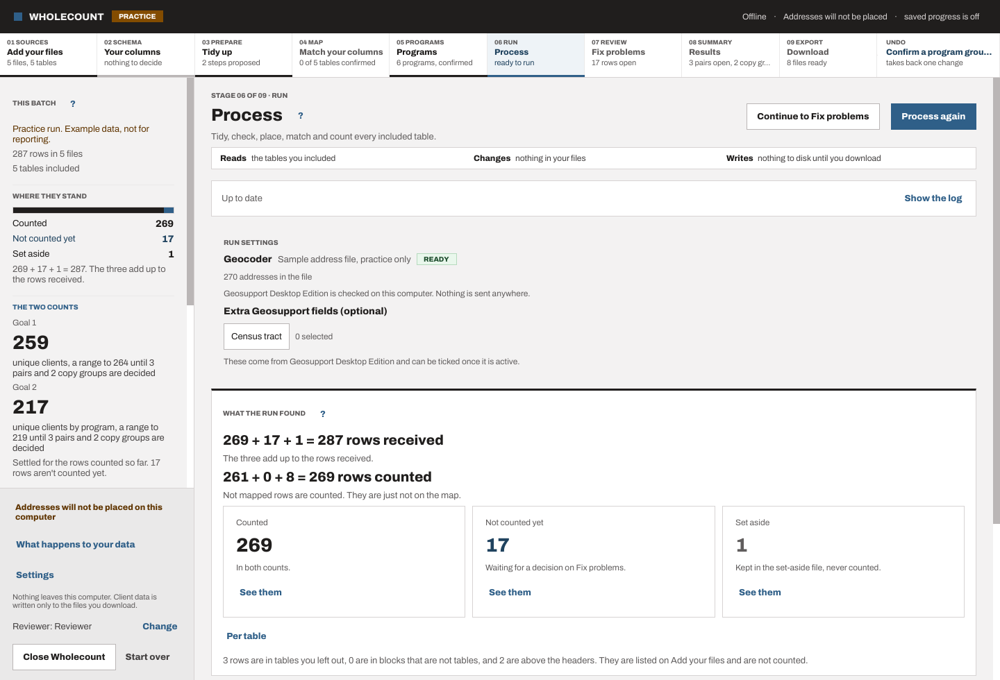
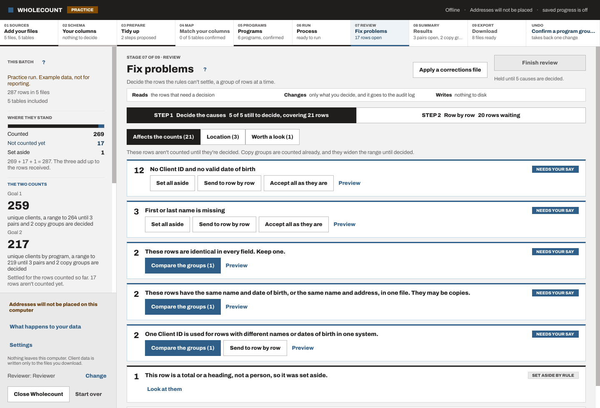
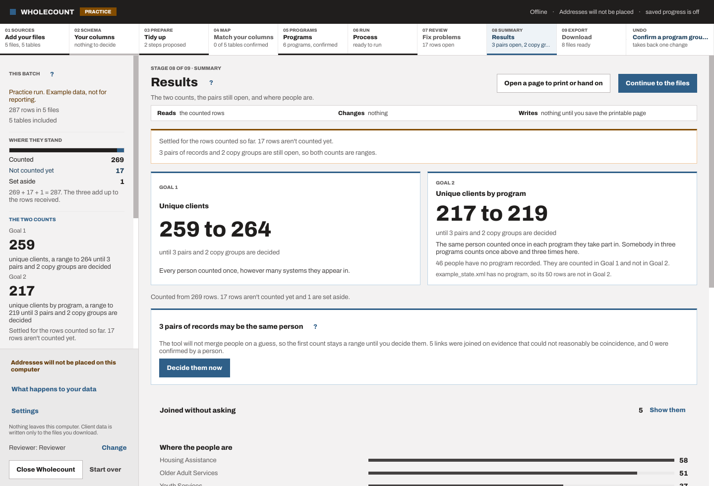
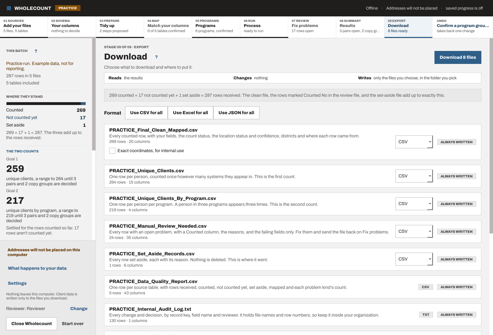

# Wholecount user guide

## Contents

1. [What Wholecount does](#what)
2. [Before you start](#before)
3. [The nine stages](#stages)
4. [Reading the results](#results)
5. [The output files](#files)
6. [What happens to your data](#data)
7. [Words used](#words)
8. [If something goes wrong](#trouble)
9. [What you should see with the example data](#example)

## 1. What Wholecount does

Wholecount merges your organization's client lists from different systems into one master list, on this computer only.

It gives two numbers. Goal 1 is how many different people you served. Goal 2 is how many people each program served, so a person in two programs counts once in each.

## 2. Before you start

Export the client lists you want to count from each system, and save them in one folder on this computer.

Wholecount reads CSV, tab-separated text, Excel workbooks, JSON and XML.

To place addresses on the map it needs Geosupport Desktop Edition or an address reference file. Without either, every row is still checked and counted, and nothing is placed.

A batch is usually one quarter's exports, often a few files to fifteen.

## 3. The nine stages

Work left to right along the stage strip. Each stage says what it reads, what it changes and what it writes.

### 01. Add your files

Brings in the client lists you exported and finds the tables in them. Drop files or browse. Untick a table to leave it out. Show data lets you check the header row.

- Reads: the files you add, once
- Changes: nothing in your files
- Writes: nothing to disk

What you decide: which files and tables to count, and which header row each table has.

A held button: Process everything is held while a file has a blocker, and its caption says which one.

### 02. Your columns

Sets the fields every file is matched to. The standard fields work for most work. Add a custom field with a type and a longest value.

- Reads: nothing from your files
- Changes: only the list of fields
- Writes: nothing to disk

What you decide: whether you need custom fields beyond the standard ones.

A held button: a change to the fields is held while a run is going.

### 03. Tidy up

Adds clean columns where a file has values jammed together. Pick a rule, then a source and its columns. A step only adds columns, and you can remove it at any time.

- Reads: the tables you included
- Changes: nothing in your files. Steps add new columns in memory
- Writes: nothing to disk

What you decide: which tidy-up steps to keep. Each one adds columns and never changes your own.

A held button: Continue is held while a step is being previewed.

### 04. Match your columns

Says which of your columns holds each field, table by table. Check each amber callout. The blue button inside picks the column the tool found that fits better.

- Reads: column names and sample values
- Changes: nothing in your files
- Writes: nothing to disk

What you decide: which of your columns holds each field, table by table.

A held button: Process is held while a required field has no column, and the blocked band names it.

### 05. Programs

Sets up the second count: clients per program. Pick each file's program column, confirm or split the proposed groups, then preview the counts.

- Reads: the program columns you chose
- Changes: nothing in your files
- Writes: nothing to disk

What you decide: each file's program column, and which program names are one program.

A held button: Process is held until every proposed program group is confirmed or split.

### 06. Process

Checks every row, places the addresses, finds copies and the same person across files, and counts. Press Process everything. It reads your files and changes nothing in them. Rows with a problem wait on Fix problems and aren't counted yet.

- Reads: the tables you included
- Changes: nothing in your files
- Writes: nothing to disk until you download

What you decide: only when to run, and whether to add extra Geosupport fields.

A held button: Process everything is held while something before it needs your decision.

### 07. Fix problems

Decides the rows the checks could not settle, a group of rows at a time and then one row at a time. Decide the causes on step 1 first. Finish review is held until every cause that affects the counts is decided. Your name is saved with each decision.

- Reads: the rows that need a decision
- Changes: only what you decide, and it goes to the audit log
- Writes: nothing to disk

What you decide: each cause on step 1, then any row left on step 2.

A held button: Finish review is held until every cause that affects the counts is decided.

The first time this stage opens it asks who is reviewing. It has three tabs: Affects the counts, Location and Worth a look. Accept all as they are shows five sample rows and asks you to type the number of rows and pick a reason, and more than 200 rows needs a second reviewer's name.

### 08. Results

Shows the two counts and where they come from. A count shows as a range while same-person pairs are open. It becomes one number once every pair is decided.

- Reads: the counted rows
- Changes: nothing
- Writes: nothing until you save the printable page

What you decide: the same-person pairs still open, and any automatic join you want to split.

A held button: the results are held while anything is out of date, and Process again releases them.

### 09. Download

Writes the files you choose into a folder you pick. Nothing is written until you press Download. A practice run writes no map files. Each data file can be CSV, Excel or JSON.

- Reads: the results
- Changes: nothing
- Writes: only the files you choose, in the folder you pick

What you decide: each file's format, which columns the clean file keeps, and the folder.

A held button: Download is held while the results are out of date, while the numbers don't add up, or while a Low confidence isn't ticked.

## 4. Reading the results

While same-person pairs are open, each count is a range: the low end if every open pair is one person, the high end if none are. Deciding every pair makes it one number.

A count is final when nothing is left to decide: no open pair, no open copy group and no row waiting.

Confidence is High, Medium or Low, from checked facts only. Same-person matches show as Certain, Likely or Possible. Green marks something a person decided, and never confidence.

Two balances must always hold. Rows received equal counted plus not counted yet plus set aside. Counted equals mapped plus counted but not mapped.

A person with no usable address is counted in both goals and is not on the map.

## 5. The output files

A download writes 9 files by default, 10 with Map_Points, and 8 in a practice run, which writes no map files.

- Final_Clean_Mapped: Every counted row, with your fields, the count status, the location status and confidence, districts and where each row came from.
- Unique_Clients: One row per person, counted once however many systems they appear in. This is the first count.
- Unique_Clients_By_Program: One row per person per program. A person in three programs appears three times. This is the second count.
- Manual_Review_Needed: Every row with an open problem, with a Counted column, the reasons, and the failing fields only. Fix them and send the file back on Fix problems.
- Set_Aside_Records: Every row set aside, each with its reason. Nothing is deleted. This is where it went.
- Map_Counts: Counts by district for each program, with no names, addresses or points. Any count from 1 to 10 is left blank and shown as "fewer than 11".
- Map_Points: One row per person and program, with a point moved 150 to 250 feet. Everyone at one building gets the same moved point. A moved point can sit across a district line from its district.
- Internal_Audit_Log: Every change and decision, by record key, field name and reviewer. It holds file names and row numbers, so keep it inside your organization.
- Shareable_Audit_Log: The same events with source letters only, no file names, no row numbers and different record keys.
- Data_Quality_Report: One row per source table, with rows received, counted, not counted yet, set aside, mapped and each problem kind's count.

Each data file can be CSV, Excel or JSON. The two audit logs are plain text and the quality report is CSV.

The internal audit log is for your organization and names files and rows. The shareable log uses source letters and different record keys, so it can go to a funder or an auditor.

A practice run names every file PRACTICE_ and marks its first column and first line PRACTICE, so it is never mistaken for real counts.

This folder copies files to other computers. These files hold client data.

## 6. What happens to your data

Your files. Opened once when you add them. Wholecount never changes them.

Memory on this computer. Every step works here: tidying, checking, placing, matching, counting. Nothing is sent anywhere. Closing Wholecount clears it.

The files you download. Written to the folder you pick. The receipt lists each one and where it went.

Never

- Sent over the internet. Wholecount cannot connect to it.
- Shown to or decided by AI. There is none in Wholecount.
- Written to a log. Neither audit log holds a name, address, date or ID from your files.
- Kept after you close, unless you saved progress.

The install secret is a key kept on this computer, encrypted for your Windows account. Settings can back it up with a passphrase and restore it.

Back up the install secret to a place your organization controls. If the secret is lost, saved progress and the saved crosswalk can't be opened again. Restoring the backup brings them back.

The saved crosswalk keeps keyed hashes, master IDs and the pair and program decisions, so a person keeps one master ID across batches and a decided pair isn't asked again. It never holds names, addresses, IDs or dates. Turn it on only after your data agreements allow linking systems, and back up the install secret first.

## 7. Words used

- Add your files: the files added and the tables found in them.
- Your columns: the fields every file is matched to.
- Tidy up: steps that add clean columns.
- Match your columns: which of your columns holds each field, table by table.
- Process: the run over every included table.
- Fix problems: open rows grouped by cause, then the queue.
- Results: Goal 1, Goal 2 and the open pairs.
- Download: the output files and the receipt.
- Set aside: out of the clean list, kept and recoverable, with a reason.
- Copies: rows in one table a person decided are one client.
- May be one person: a same-person pair waiting for a decision.
- Look up from the street: a value worked out from the row's own address.
- Set-up: everything saved for reuse except decisions.
- Master ID: one ID per person, the unit of Goal 1.
- Record key: a row's stable identity.
- Source system: a group of files that share one identifier space.
- Run ticker: the progress line under the stage strip.

## 8. If something goes wrong

If Wholecount stops, it shows an error code and nothing else. Copy the code and send it to whoever supports Wholecount. The code never holds a value from your files.

A gray, held button always has a caption under it that says what releases it.

If a file won't read, Add your files says why in one sentence and counts every row it couldn't read.

If Geosupport isn't found, the system check line in the ledger footer says so, and rows are still checked and counted.

The installer adds two Windows Firewall rules that block Wholecount from the network. If they couldn't be added, the installer's last page says so.

## 9. What you should see with the example data

Try example data loads five made-up files, one table each once the workbook's header row is chosen. The run is marked PRACTICE and writes no map files.

With the planned decisions made, 287 rows are received: 269 counted, 15 not counted yet and 3 set aside. Of the counted rows, 261 are mapped and 8 are counted but not mapped. Goal 1 is 261 people and Goal 2 is 219.
